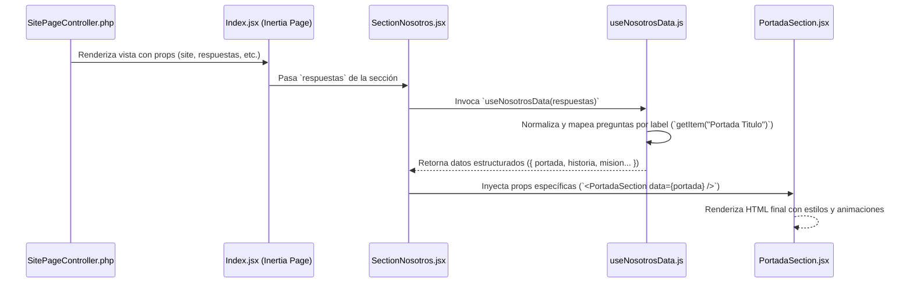

# Documentación Técnica y Arquitectura del Proyecto (CMS Multi-Tenant)

Esta guía explica en detalle el funcionamiento integral del sistema, desde la configuración y permisos en el Panel Administrativo (Filament) hasta la renderización dinámica en el Frontend (React + Inertia.js).

---

## 1. Gestión de Roles y Permisos (Filament Shield)

El proyecto utiliza **Spatie Laravel Permission** junto con **Filament Shield** para la administración visual de roles y permisos.

### ¿Cómo crear un Rol y asignar permisos?
1. **Acceso al Panel:** Ingresa al panel administrativo Filament (`/admin`).
2. **Navegación:** En el menú lateral, dirígete a **Seguridad / Roles** (`Filament/Resources/Roles`).
3. **Crear Rol:** Haz clic en **"Nuevo Rol"**.
4. **Campos:**
   - **Name:** Nombre del identificador técnico del rol (ej: `super_admin`, `editor`, `vendedor`).
   - **Guard:** Debe ser `web`.
5. **Permisos por Recurso:** Shield auto-descubre tus recursos (Sites, Plantillas, Productos, Usuarios, etc.) y genera permisos granulares:
   - `viewAny`, `view`, `create`, `update`, `delete`, `deleteAny`, `restore`, `forceDelete`.
   - Marca las casillas de verificación según los privilegios deseados para ese rol.
6. **Guardar:** Haz clic en **"Crear"** o **"Guardar cambios"**.

---

## 2. Gestión de Usuarios

Ubicación del recurso: `app/Filament/Resources/Users/UserResource.php`.

### ¿Cómo crear un Usuario?
1. En el menú lateral de Filament, ve a **Usuarios**.
2. Presiona el botón **"Nuevo Usuario"**.
3. **Campos:**
   - **Name:** Nombre completo del usuario.
   - **Email:** Correo electrónico único de acceso.
   - **Password:** Contraseña cifrada con `bcrypt`.
   - **Roles:** Selector múltiple vinculado con Spatie. Selecciona los roles que tendrá asignado este usuario (por ejemplo: `super_admin` o `editor`).
   - **Sites / Asignación:** Si el usuario administra tiendas o sitios específicos, se asigna su relación de pertenencia.
4. Presiona **"Crear"**. El usuario ya podrá autenticarse según sus políticas y permisos asociados.

---

## 3. Motor Dinámico de Contenido: Plantillas, Secciones, Preguntas y Respuestas

Este es el núcleo CMS del proyecto: permite que una misma plantilla sirva a múltiples sitios web (multi-tenant), cambiando textos, banners, colores, enlaces e imágenes sin tocar código.

### Estructura y Jerarquía de la Base de Datos

```mermaid
graph TD
    P[Plantilla (ej. Ecomer)] --> S[Secciones (ej. Inicio, Nosotros, Contacto)]
    S --> Q[Preguntas (Campos configurables)]
    SITE[Site (Tenant: Tienda Choqueplast)] --> R[Respuestas (Valores por Sitio)]
    Q --> R
```

1. **`Plantilla` (`plantillas`)**:
   - Define el tema o diseño visual base (ej: `Ecomer`, `Restaurante`, `Corporativo`).
   - Identificado por un slug o tipo que coincide con la carpeta en React (`resources/js/pages/sites/{plantillaTipo}`).

2. **`Sección` (`seccions`)**:
   - Representa una página o bloque temático dentro de la plantilla.
   - Ejemplos: `Inicio`, `Nosotros`, `Contacto`, `Tienda`, `Footer`.
   - Tiene campos como `nombre`, `tipo`, `orden`, `estado`.

3. **`Pregunta` (`preguntas`)**:
   - Representa un campo editable dentro de una sección.
   - Posee un `label` o etiqueta reconocible (ej: `Titulo Portada`, `Imagen Misión`, `Banner Principal`).
   - Posee un `tipo` (tipo de dato/control).

4. **`Respuesta` (`respuestas`)**:
   - Guarda el valor real ingresado para un sitio determinado.
   - Relaciona: `site_id`, `pregunta_id`, `valor` (texto, ruta de archivo, JSON), y opcionalmente `enlace` (URL de redirección).

---

### ¿Para qué sirven los Tipos de Pregunta (`tipo`)?

En Filament (`app/Filament/Resources/Plantillas/` y `app/Filament/Resources/Sites/Schemas/SiteForm.php`), el campo `tipo` determina qué componente visual se dibuja al editar el sitio:

| Tipo (`tipo`) | Componente en Filament | Propósito / Uso | Formato del `valor` |
| :--- | :--- | :--- | :--- |
| **`texto`** | `TextInput` | Títulos cortos, subtítulos, nombres, eslóganes. | String corto (`"Bienvenidos a nuestra tienda"`) |
| **`textarea`** | `Textarea` o `RichEditor` | Párrafos largos, historia, misión, descripción de empresa. | String multilínea o HTML |
| **`imagen`** | `FileUpload` (disk: `public`) | Banners, logos, fotos de equipo, fondos de sección. | Ruta relativa (`sites/banners/portada.webp`) |
| **`video`** | `TextInput` o `FileUpload` | URLs de YouTube/Vimeo o archivo MP4 local. | URL o ruta de archivo |
| **`enlace`** | `TextInput` | Botones de llamado a la acción (CTA), links de WhatsApp, redes. | URL o slug (`https://wa.me/...`) |
| **`color`** | `ColorPicker` | Personalización de colores primarios/secundarios por sección. | Hexadecimal (`#10B981`) |
| **`repeater`** | `Repeater` (JSON) | Listados dinámicos (preguntas frecuentes FAQ, slides, testimonios). | JSON estructurado |

---

## 4. Arquitectura Backend: Multi-tenancy y SitePageController

Cuando un cliente ingresa a un dominio (ej: `https://magnusonline.com.pe` o `/site/ecomer`):

1. **Resolución de Tenant en `SitePageController.php`:**
   - Resuelve el sitio mediante el dominio actual (`request()->getHost()`) o mediante el parámetro `slug`.
2. **Carga de Datos:**
   - Obtiene las secciones activas de la plantilla vinculada.
   - Carga todas las `respuestas` del `site` organizadas por `seccion_id` y `pregunta_id`.
3. **Envío hacia Inertia.js:**
   ```php
   return Inertia::render("sites/{$plantillaTipo}/Index", [
       'site' => $site,
       'secciones' => $secciones,
       'seccionActiva' => $seccionActiva,
       'respuestas' => $respuestasAgrupadas,
       'theme' => $themeConfig,
   ]);
   ```

---

## 5. Arquitectura Frontend: React + Inertia

La estructura frontend se ubica en: `resources/js/pages/sites/Ecomer/`

```text
resources/js/pages/sites/Ecomer/
├── Index.jsx                     # Componente principal que orquesta el sitio
├── components/
│   ├── Nosotros/
│   │   ├── SectionNosotros.jsx   # Contenedor de la sección "Nosotros"
│   │   ├── hooks/
│   │   │   └── useNosotrosData.js # Hook extractor y normalizador de respuestas
│   │   └── subcomponents/
│   │       ├── PortadaSection.jsx
│   │       ├── HistoriaSection.jsx
│   │       ├── MisionVisionSection.jsx
│   │       ├── ElegirnosSection.jsx
│   │       └── AccionSection.jsx
│   ├── Inicio/
│   ├── Contacto/
│   └── Shared/                   # Navbar, Footer, etc.
```

### El Flujo de Datos en el Frontend



---

### ¿Cómo funcionan los Hooks (`useNosotrosData.js`)?

El hook aísla al componente visual de la estructura cruda de la base de datos. Si una pregunta en la base de datos cambia o se agrega un valor por defecto, solo se modifica el hook:

```javascript
// resources/js/pages/sites/Ecomer/components/Nosotros/hooks/useNosotrosData.js
import { useMemo } from 'react';

export const useNosotrosData = (respuestas = []) => {
    return useMemo(() => {
        // Función utilitaria para buscar respuesta por el label de la pregunta
        const getItem = (label) => {
            const item = respuestas.find(
                (r) => r.pregunta?.label?.toLowerCase().trim() === label.toLowerCase().trim()
            );
            return {
                valor: item?.valor || '',
                enlace: item?.enlace || '',
            };
        };

        // Estructuración por subcomponentes
        return {
            portada: {
                titulo: getItem('Portada Titulo').valor || 'Nosotros',
                subtitulo: getItem('Portada Subtitulo').valor || 'Nuestra trayectoria',
                imagenFondo: getItem('Portada Imagen').valor,
            },
            historia: {
                titulo: getItem('Historia Titulo').valor,
                descripcion: getItem('Historia Descripcion').valor,
                imagen: getItem('Historia Imagen').valor,
            },
            misionVision: {
                mision: getItem('Misión Texto').valor,
                vision: getItem('Visión Texto').valor,
            }
        };
    }, [respuestas]);
};
```

---

### Consumo en el Componente y Subcomponentes

#### 1. Componente Contenedor (`SectionNosotros.jsx`):
```jsx
import React from 'react';
import { useNosotrosData } from './hooks/useNosotrosData';
import PortadaSection from './subcomponents/PortadaSection';
import HistoriaSection from './subcomponents/HistoriaSection';

export default function SectionNosotros({ respuestas }) {
    // 1. Extraemos los datos a través del hook
    const { portada, historia, misionVision } = useNosotrosData(respuestas);

    return (
        <div className="section-nosotros">
            {/* 2. Pasamos únicamente lo que cada subcomponente necesita */}
            <PortadaSection data={portada} />
            <HistoriaSection data={historia} />
        </div>
    );
}
```

#### 2. Subcomponente Visual (`PortadaSection.jsx`):
```jsx
import React from 'react';

export default function PortadaSection({ data }) {
    if (!data) return null;

    return (
        <section 
            className="hero-nosotros"
            style={{ backgroundImage: `url(/storage/${data.imagenFondo})` }}
        >
            <div className="container">
                <h1>{data.titulo}</h1>
                <p>{data.subtitulo}</p>
            </div>
        </section>
    );
}
```

---

## 6. Paso a Paso: Cómo Agregar un Nuevo Campo de Contenido Dinámico

Si quieres agregar un nuevo campo (por ejemplo: *"Teléfono de Emergencia"* en la sección de Contacto):

1. **Crear la Pregunta en Filament:**
   - Ve a **Plantillas** -> Selecciona tu plantilla (ej. `Ecomer`).
   - En la sección **Contacto**, añade una nueva pregunta con:
     - **Label:** `Telefono Emergencia`
     - **Tipo:** `texto`
2. **Llenar el valor en el Sitio:**
   - Ve a **Sitios** -> Edita tu sitio.
   - En la pestaña **Contacto**, aparecerá el nuevo campo. Ingresa el valor (ej. `+51 999 888 777`) y guarda.
3. **Mapear en el Hook de React:**
   - Abre `resources/js/pages/sites/Ecomer/components/Contacto/hooks/useContactoData.js`.
   - Agrega:
     ```javascript
     telefonoEmergencia: getItem('Telefono Emergencia').valor,
     ```
4. **Mostrar en el Subcomponente:**
   - En el subcomponente correspondiente (ej. `ContactoInfo.jsx`):
     ```jsx
     <span>Emergencias: {data.telefonoEmergencia}</span>
     ```

¡Listo! No se requiere ninguna migración de base de datos ni modificaciones de tablas. Todo fluye a través del motor dinámico EAV (Entidad-Atributo-Valor) de la aplicación.
